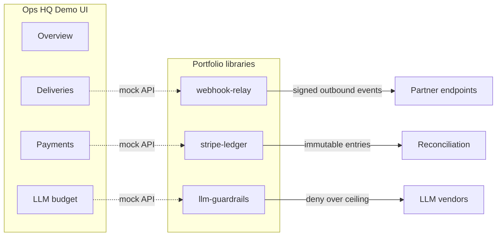

# Ops HQ Demo

[](https://github.com/marchikx/ops-hq-demo/actions/workflows/ci.yml) 

**Live demo:** https://marchikx.github.io/ops-hq-demo/ — static build of `data/seed.json`, no login.

Small **dark-mode operations dashboard** for a GitHub portfolio. It demonstrates how three backend-adjacent libraries fit together — without npm-linking sibling repos. Thin mocks live under `lib/` and read from `data/seed.json`.

## What you see

| Route | Concept |
|-------|---------|
| `/` | KPI overview across webhooks, ledger, and LLM gate |
| `/deliveries` | Webhook outbox — retries, DLQ, next worker action |
| `/payments` | Payment ledger — charges, refunds, payouts |
| `/llm-budget` | LLM daily ceiling and `assertLlmAllowed`-style gate |

Visual language: charcoal surfaces, **teal** accent, one CSS **fade-in** on main content — no purple “AI glow” cliché.

## Portfolio wiring (conceptual)



In production, each box would be a real service or package; here `lib/mockWebhook.ts`, `lib/mockPayments.ts`, and `lib/mockLlm.ts` mirror the **contracts** only.

## Decisions / trade-offs

- **Mocks in-repo** vs npm-linking sibling packages — one clone runs the story; sibling repos stay the source of truth for real code.
- **Next.js UI only** — no live Stripe/Telegram; keeps `npm run verify` fast and secret-free.
- **Teal ops aesthetic** — readable KPI shell for interviews, not a full design-system product.

## Develop

```bash
npm install
npm run dev    # http://localhost:3000
npm run verify # vitest + tsc (CI-fast)
npm run build  # full Next.js production build
```

Copy `.env.example` to `.env.local` if you want to document env names locally; the demo does not require secrets to run.

## Tests

Unit tests cover the three mock modules:

```bash
npm test
```

## Hire note

This repo is a **flagship UI shell** meant to sit next to focused libraries (webhook relay, Stripe-style ledger, LLM spend gate). If you are hiring for platform or fintech-adjacent product engineering, start here for narrative and UX, then dive into the sibling repos for implementation depth.

## License

MIT — see [LICENSE](LICENSE).
