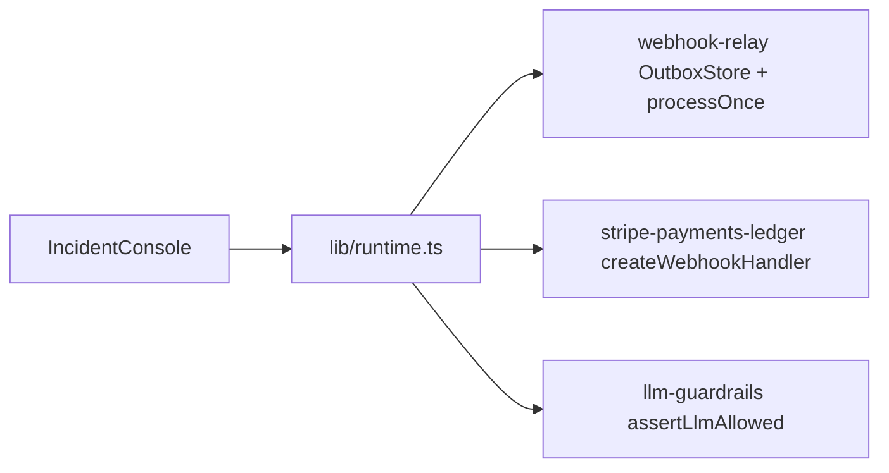

# Ops HQ Demo

[](https://github.com/marchikx/ops-hq-demo/actions/workflows/ci.yml) 

**Live:** https://marchikx.github.io/ops-hq-demo/

Interactive ops console that **imports** three sibling packages (`file:` deps) and runs failure paths in the browser:

1. **webhook-relay** — enqueue → HMAC-signed POST → retry → DLQ  
2. **stripe-payments-ledger** — signed webhook → `202` + `processWork`  
3. **llm-guardrails** — near-cap deny + `UNKNOWN_MODEL` deny  

KPI tables still read coherent `data/seed.json`. The **Run incident** panel is live library code.

## Import graph (real)



## Routes

| Route | What |
|-------|------|
| `/` | Hero + interactive incident + seed KPIs |
| `/deliveries` | Seed outbox table |
| `/payments` | Seed ledger |
| `/llm-budget` | Seed budget snapshot |

## Develop

```bash
npm install
npm run verify   # vitest (incl. runtime wiring) + tsc
npm run build
npm run test:e2e # Playwright against local next start
```

GitHub Pages: `npm run build:pages` → `out/` (workflow `pages.yml`).

## Hire

Open a hire request: https://github.com/marchikx/marchikx/issues/new?template=hire.md  
I reply ≤24h with three ready technical checks.

## License

MIT — see [LICENSE](LICENSE).
