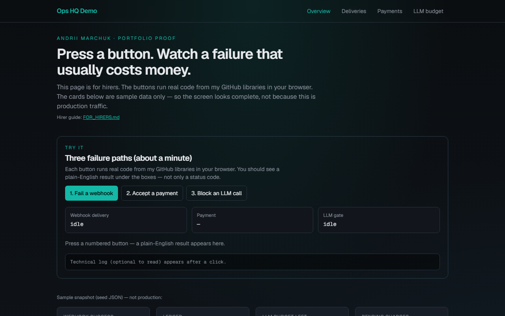
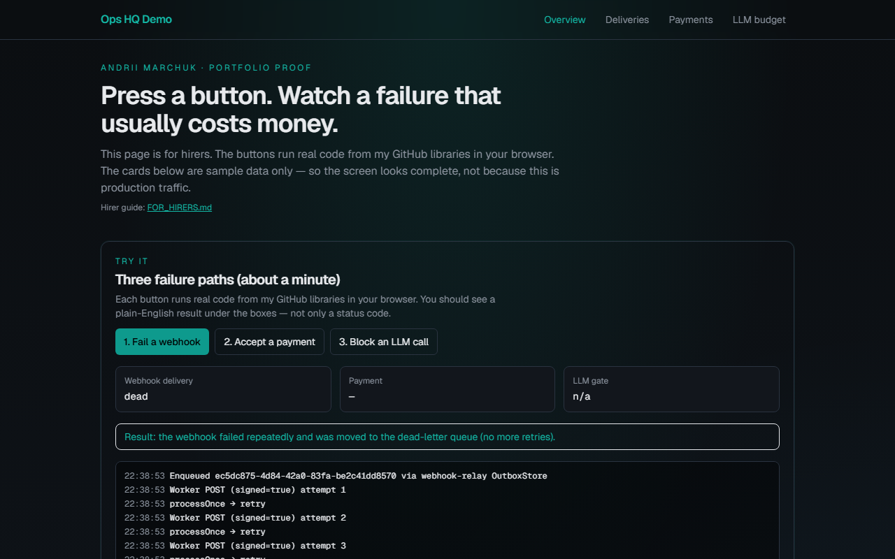
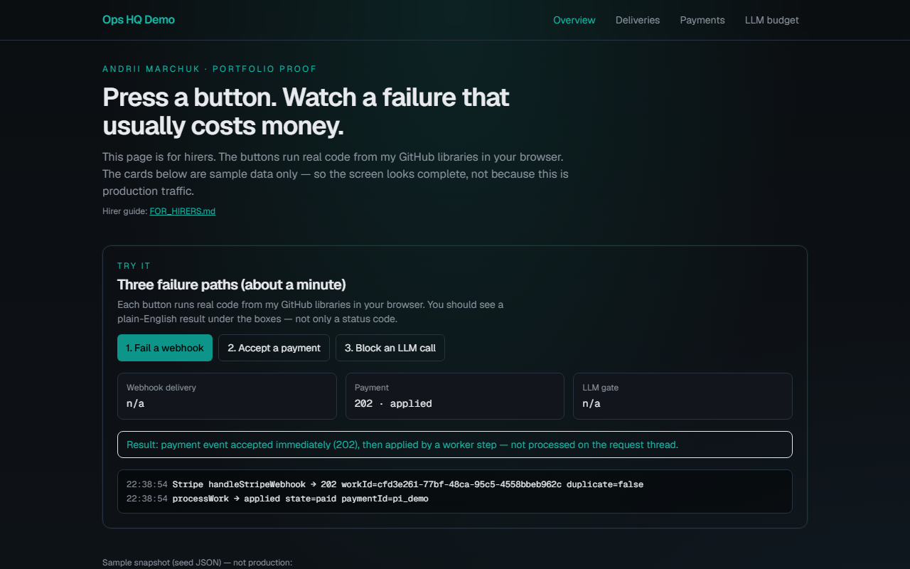
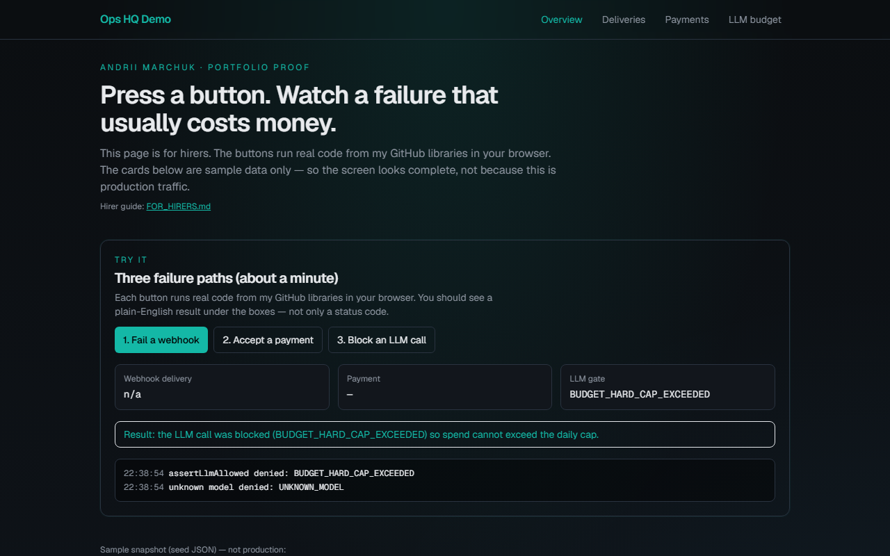

# Walkthrough — three buttons (screenshots)

Live URL: https://marchikx.github.io/ops-hq-demo/

These shots are from Playwright against the live Pages site after cold-hire copy landed (`c98714b`).

## 0. First screen

Plain headline: press a button, watch a money-path failure. No jargon before the first click.

## 1. Fail a webhook

Click **1. Fail a webhook** → status becomes `dead` and a Result sentence explains dead-letter.

## 2. Accept a payment

Click **2. Accept a payment** → `202` accept, then worker applied.

## 3. Block an LLM call

Click **3. Block an LLM call** → blocked / spend gate message.

Hirer guide: [FOR_HIRERS.md](./FOR_HIRERS.md).
